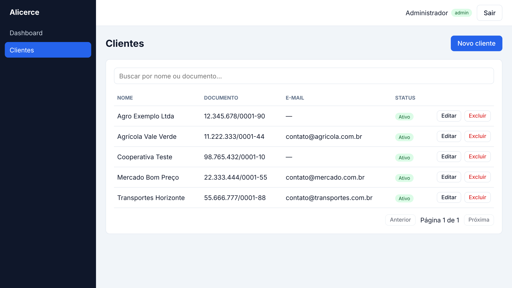
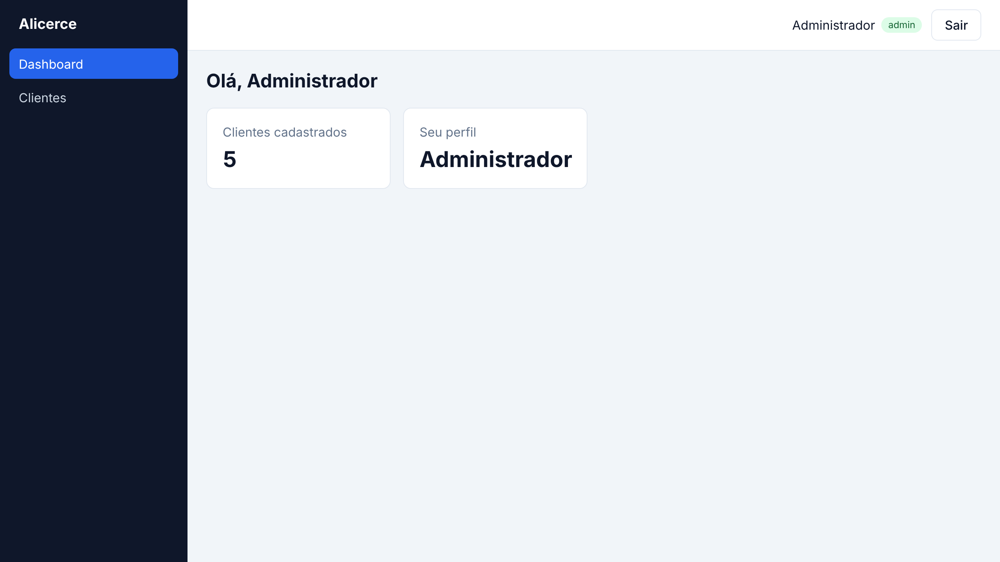
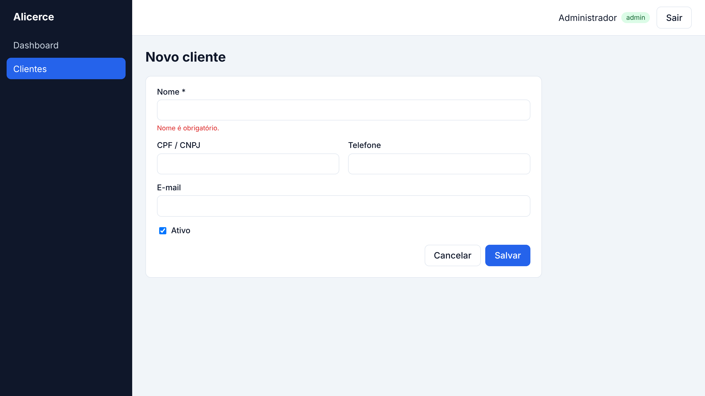
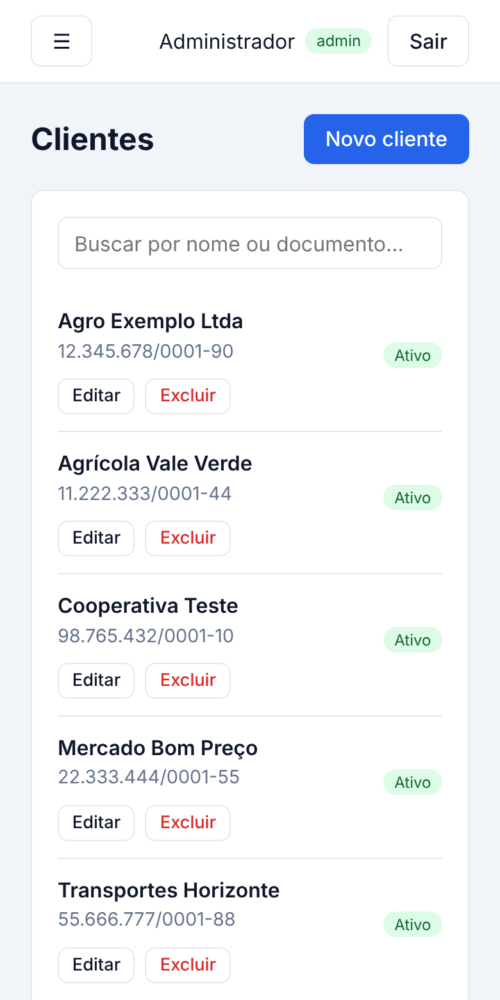
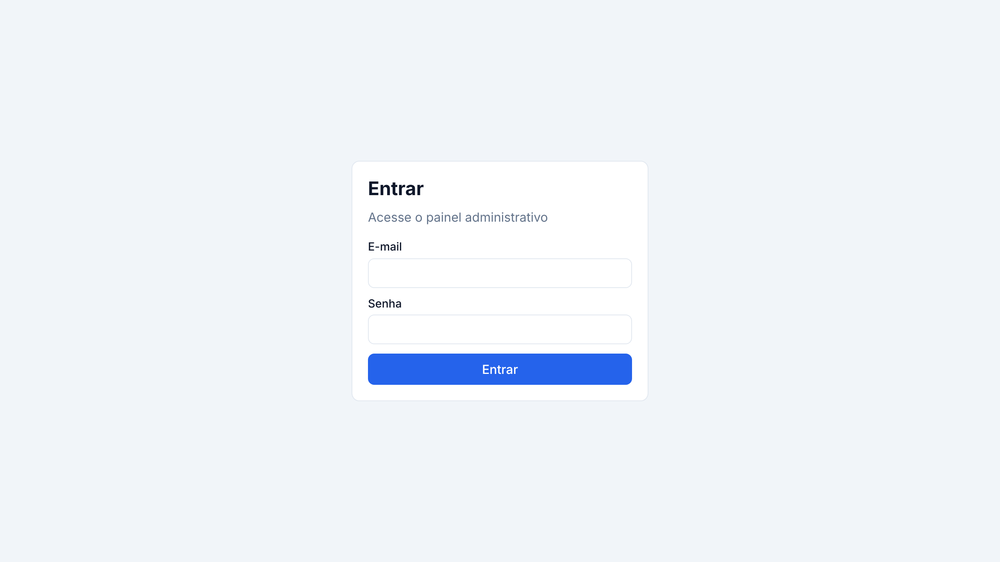
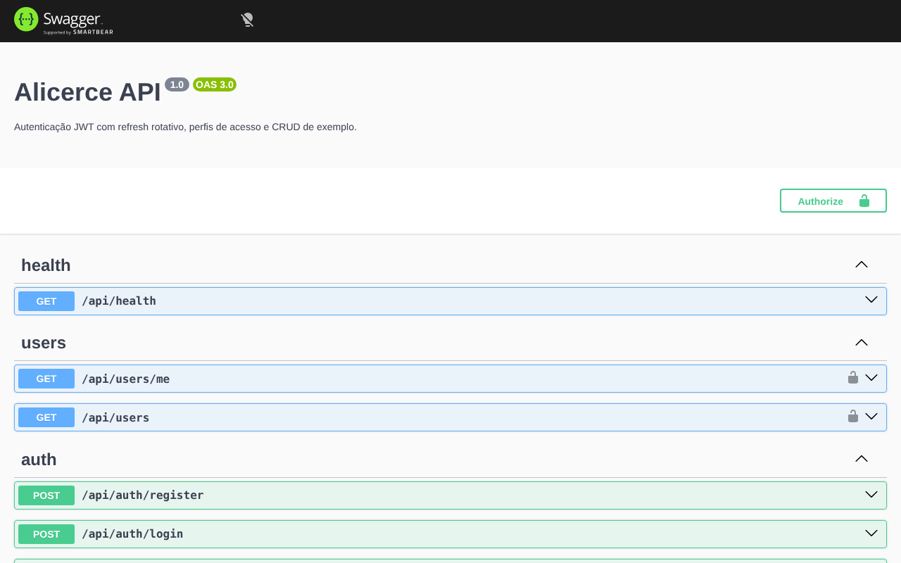

# Alicerce

[](https://github.com/r4faelFSilva/alicerce/actions/workflows/ci.yml)


**A production-minded starter kit for admin dashboards and internal business systems — Angular + NestJS + PostgreSQL.**

🇧🇷 [Leia em português](README.pt-BR.md)

<p align="center">
  
</p>

## Why

Every internal system starts the same way: authentication, refresh tokens, guards, roles,
an admin layout, a first CRUD, Docker. *Alicerce* ("foundation" in Portuguese) gives you
that foundation already built, tested and documented, so the first day of a project is
spent on the business problem.

## Features

- **JWT auth with refresh token rotation** — a reused refresh token is rejected
- **Protected by default** — a global guard secures every route; opt out with `@Public()`
- **Role-based access control** (`admin` / `user`) on both the API and the UI
- **Silent session renewal** — HTTP interceptor refreshes the token and queues concurrent 401s
- **Example CRUD** with search, pagination and validation (copy it for new modules)
- **Responsive admin layout** — sidebar, top bar, dashboard; tables turn into cards on mobile
- **OpenAPI docs** at `/api/docs` (Swagger UI, generated from the DTOs)
- **Docker Compose** with PostgreSQL, API and web app
- **CI** on GitHub Actions — build and tests for both apps on every push
- **AI-ready** — `CLAUDE.md` with the project conventions and a `/novo-crud` command for Claude Code

## Tech stack

| Layer | Tech |
|---|---|
| Frontend | Angular 22 — standalone components, signals, zoneless, `rxResource`, no UI library |
| Backend | NestJS 12 (ESM), TypeORM, class-validator, `@nestjs/jwt` |
| Database | PostgreSQL 17 |
| Tooling | Docker, Vitest, GitHub Actions, Swagger |

## Screenshots

| Dashboard | Validation | Mobile |
|---|---|---|
|  |  |  |

<details>
<summary>Login and API docs</summary>




</details>

## Getting started

Requirements: Node.js 22+, Docker.

```bash
# 1. Database
docker compose up -d db

# 2. API  →  http://localhost:3000/api  (docs: /api/docs)
cd backend
cp .env.example .env
npm install --legacy-peer-deps
npm run start:dev

# 3. Web app  →  http://localhost:4200
cd frontend
npm install
npm start
```

Sign in with `admin@exemplo.com` / `Admin@12345` (set in `backend/.env`).

Or run everything in containers:

```bash
cp backend/.env.example backend/.env
docker compose up --build
```

## API

| Method | Route | Access |
|---|---|---|
| POST | `/api/auth/register` · `/login` · `/refresh` | Public |
| POST | `/api/auth/logout` | Authenticated |
| GET | `/api/users/me` | Authenticated |
| GET | `/api/users` | Admin |
| GET · POST · PATCH | `/api/customers` | Authenticated |
| DELETE | `/api/customers/:id` | Admin |
| GET | `/api/health` | Public |

Full interactive docs at `http://localhost:3000/api/docs`.

## Project structure

```
alicerce/
├── backend/            NestJS API
│   └── src/
│       ├── auth/       login, refresh, guards (JWT + roles)
│       ├── users/      user entity and admin seed
│       ├── customers/  example CRUD — the pattern for new modules
│       └── common/     decorators (@Public, @Roles, @CurrentUser)
├── frontend/           Angular app
│   └── src/app/
│       ├── core/auth/  auth service, interceptor, guards
│       ├── layout/     admin shell
│       └── features/   login, dashboard, customers
├── docs/screenshots/
└── docker-compose.yml
```

## Design notes

**Why refresh tokens are hashed with SHA-256, not bcrypt.** bcrypt only reads the first
72 bytes of its input. JWTs issued to the same user share a long common prefix (header
and most of the payload), so with bcrypt an old, already-rotated refresh token would still
match the stored hash, silently defeating rotation. This was caught by a test that reuses a
token. Tokens are now hashed with SHA-256, carry a unique `jti`, and are compared with
`timingSafeEqual`. Passwords still use bcrypt.

**Why no UI library.** The layout is ~150 lines of SCSS with CSS variables. It keeps the
bundle small and makes the kit easy to re-skin or to plug into any component library later.

## Developing with AI

The repository is set up for [Claude Code](https://claude.com/claude-code):

- `CLAUDE.md` documents the stack, conventions and security rules.
- `/novo-crud product with name, price and stock` scaffolds a full module (API + UI)
  following the `customers` pattern, then builds both apps to check the result.

## Roadmap

- [ ] TypeORM migrations for production
- [ ] Audit trail (who changed what, and when)
- [ ] Configurable approval workflow
- [ ] Granular permissions (beyond admin / user)

## License

[MIT](LICENSE) © Rafael Francisco da Silva
