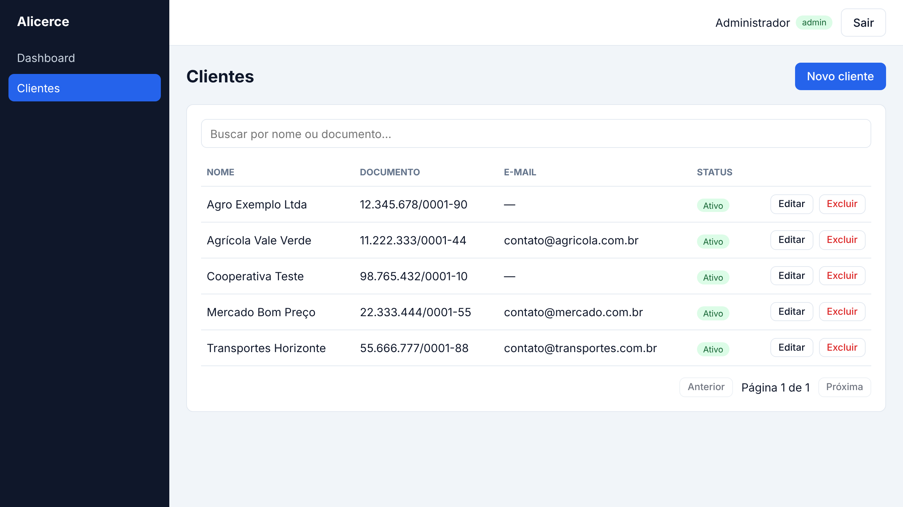

# Alicerce

[](https://github.com/r4faelFSilva/alicerce/actions/workflows/ci.yml)


**Starter kit para painéis administrativos e sistemas internos — Angular + NestJS + PostgreSQL.**

🇺🇸 [Read in English](README.md)

<p align="center">
  
</p>

## Por quê

Todo sistema interno começa igual: autenticação, refresh token, guards, perfis, layout
administrativo, o primeiro CRUD, Docker. O Alicerce entrega essa base pronta, testada e
documentada, para o primeiro dia do projeto ser gasto no problema de negócio.

## Funcionalidades

- **Autenticação JWT com refresh token rotativo** — token reutilizado é rejeitado
- **Protegido por padrão** — guard global em todas as rotas; libere com `@Public()`
- **Controle de acesso por perfil** (`admin` / `user`) na API e na interface
- **Renovação automática de sessão** — interceptor renova o token e enfileira 401 simultâneos
- **CRUD de exemplo** com busca, paginação e validação (modelo para novos módulos)
- **Layout administrativo responsivo** — no celular, a tabela vira cartões
- **Documentação OpenAPI** em `/api/docs` (Swagger, gerada a partir dos DTOs)
- **Docker Compose** com PostgreSQL, API e frontend
- **CI** no GitHub Actions — build e testes das duas aplicações a cada push
- **Pronto para IA** — `CLAUDE.md` com as convenções e comando `/novo-crud` para o Claude Code

## Rodando

Requisitos: Node.js 22+ e Docker.

```bash
# 1. Banco
docker compose up -d db

# 2. API  →  http://localhost:3000/api  (docs: /api/docs)
cd backend
cp .env.example .env
npm install --legacy-peer-deps
npm run start:dev

# 3. Frontend  →  http://localhost:4200
cd frontend
npm install
npm start
```

Login: `admin@exemplo.com` / `Admin@12345` (definidos em `backend/.env`).

Tudo em containers: `cp backend/.env.example backend/.env && docker compose up --build`.

## Decisões de projeto

**Por que o refresh token usa SHA-256 e não bcrypt.** O bcrypt só lê os primeiros 72 bytes
da entrada. JWTs do mesmo usuário compartilham um prefixo longo (header e quase todo o
payload), então com bcrypt um refresh token antigo, já rotacionado, continuaria batendo com
o hash salvo — anulando a rotação sem nenhum erro aparente. Um teste de reuso de token
pegou o problema. Hoje os tokens usam SHA-256, levam um `jti` único e são comparados com
`timingSafeEqual`. Senhas continuam com bcrypt.

Mais detalhes (endpoints, estrutura de pastas, roadmap) no [README em inglês](README.md).

## Licença

[MIT](LICENSE) © Rafael Francisco da Silva
